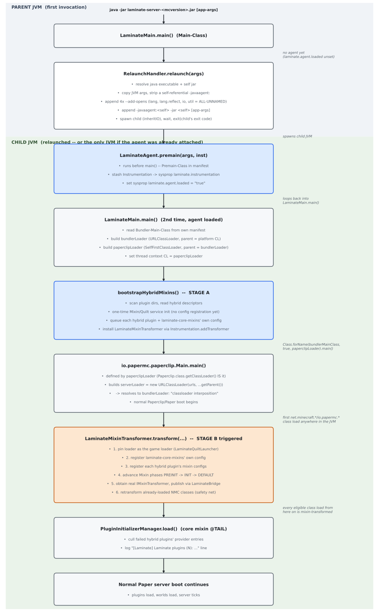
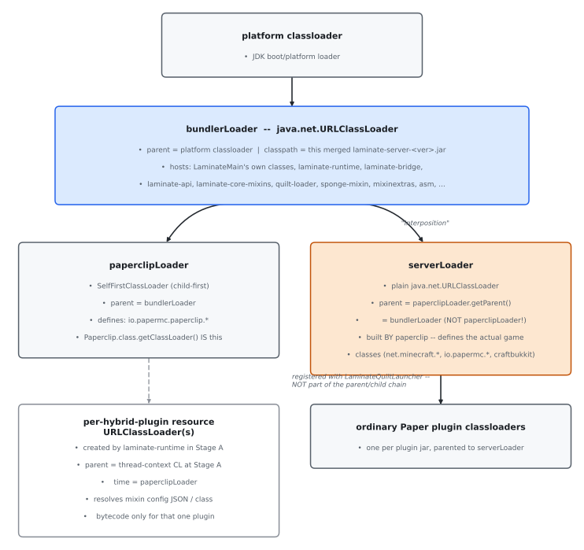

// ============================================================
[[architecture]]
== 2. Architecture Overview
// ============================================================

=== 2.1. What laminate-standalone adds

`laminate-standalone` does not fork Paper's source at all. The Paper server jar it ships is the
official, unmodified "paperclip" jar published by PaperMC for a given `paperVersion`, downloaded
and sha256-verified at *Gradle build time* (see <<build,Build-Time Paper Bundling>>) and merged
byte-for-byte with this project's own first-party classes into one bootable
`laminate-server-<paperVersion>.jar`. There is no source patch stack to maintain against
upstream Paper.

On top of that unmodified jar, `laminate-standalone` layers one narrow, deep capability: loading
ordinary Bukkit/Paper plugins that additionally ship
https://github.com/SpongePowered/Mixin[SpongePowered Mixin] bytecode transforms ("hybrid
plugins") against the live server, plus a handful of always-on mixins of its own
(<<core-mixins,Chapter 8>>) that reproduce a few Paper-internal UX behaviors the old forked
project used to implement via direct source edits.

The central problem is ordering. The JVM's `java.lang.instrument.ClassFileTransformer` API must
be registered *before* a class is first loaded — some Mixin operations (field injection, in
particular) cannot be applied retroactively to an already-loaded class. Paper's own plugin
system loads plugin classes far too late for this: by the time a plugin's `onEnable()` runs,
essentially every `net.minecraft.*`/`io.papermc.*` class the server needs has already been
loaded and defined by the JVM. `laminate-standalone` therefore pushes the entire mixin setup —
agent attachment, classloader construction, and installing the transformer — to the very
beginning of the JVM's life, strictly before paperclip loads a single Minecraft class, using only
a self-relaunch, a Java agent, and careful classloader parenting (no source patches involved).

=== 2.2. The startup pipeline

The full flow from `java -jar laminate-server-<mcversion>.jar` to a running Paper server, across
two JVM processes:

The diagram is generated from `docs/diagrams-src/generate_diagrams.py` (plain Python + matplotlib,
no external rendering service) — regenerate it with `python generate_diagrams.py` from that
directory whenever this pipeline changes; the SVGs under `docs/adoc/diagrams/` are committed
output, not produced at documentation-build time.

Two things worth calling out explicitly, since they are easy to get wrong by analogy with the
old forked project:

* The four `--add-opens` flags are *not* eliminated in this design — `RelaunchHandler` still adds
  exactly the same four flags (`java.base/java.lang`, `java.base/java.lang.reflect`,
  `java.base/java.io`, `java.base/java.util`, each `=ALL-UNNAMED`) the old fork's launcher added,
  for the same reason: the Quilt/Mixin framework reflectively pokes at sealed JDK internals.
  Compiling core mixins against paperweight userdev removes the need for a source-patched Paper,
  not the need for these JVM flags.
* Stage A (queuing hybrid plugins and installing the transformer "gate") always runs before
  `Bundler-Main-Class` is invoked, but Stage B (actually registering mixin configs and obtaining
  a real `IMixinTransformer`) is deliberately deferred — see <<bootstrap,Chapter 5>> for why Mixin
  target resolution cannot succeed any earlier than the first real game class load, and how the
  "lazy gate" makes that safe.

=== 2.3. Module map

[cols="1,2,2"]
|===
|Module |Purpose |Key files

|`laminate-launcher`
|Self-relaunching entry point and Java agent. Produces the `Main-Class`/`Premain-Class` of the
final `laminate-server` jar; detects whether the agent + JVM flags are present and relaunches a
child JVM if not; constructs `bundlerLoader`/`paperclipLoader` and hands off to Paperclip.
|`LaminateMain`, `RelaunchHandler`, `PluginArguments`, `LaminateAgent`

|`laminate-runtime`
|Hybrid-plugin discovery and Quilt/Mixin environment orchestration — the two-stage "lazy gate"
bootstrap and the `ClassFileTransformer` that drives it.
|`LaminateRuntimeBootstrap`, `LaminateQuiltLauncher`, `LaminateMixinTransformer`,
`HybridPluginDescriptor`/`HybridPluginDescriptorReader`, `PluginJarCollector`

|`laminate-bridge`
|Tiny, dependency-free module holding cross-classloader state (`LaminateBridge`, which loaded/
failed hybrid plugins) and a minimal logging shim (`LaminateLog`) that actually reaches
`logs/latest.log`. Depended on by `laminate-runtime` and `laminate-core-mixins` alike.
|`LaminateBridge`, `LaminateLog`

|`laminate-core-mixins`
|Laminate's own always-on mixin config against vanilla Paper — no plugin required. Reimplements a
handful of Paper-internal UX behaviors (failed hybrid plugin culling, the "Laminate Plugins" line
in `/plugins`, hard-blocking `/reload`) that the old fork implemented as direct source edits, now
as ordinary mixins compiled against paperweight userdev.
|`PluginInitializerManagerMixin`, `ReloadCommandMixin`, `PaperPluginsCommandMixin`,
`laminate-core.mixins.json`

|`laminate-api`
|Compile-time annotation processors and runtime bridges for hybrid plugin authors:
`@GenerateAccessor` (typed accessor interfaces for mixin-injected methods) and `@InjectEvent`/
`@Rewrite`/`@At` (generates companion mixins that fire Bukkit events from NMS injection points).
|`GenerateAccessorProcessor`, `InjectEventProcessor`, `LaminateEventBridge`, `LaminateAccessors`,
`JvmDescriptors`

|`test-plugin`
|Reference hybrid plugin exercising the whole pipeline end to end.
|`TestPlugin`, `ServerMixin`, `ServerLevelMixin`, `plugin.yml`

|`buildSrc`
|Build-time-only logic (not shipped in the server jar): downloads and sha256-verifies the
official Paper paperclip jar for `paperVersion`, then merges it with this project's own compiled
output into the bootable server jar.
|`PaperclipResolver`, `DownloadPaperclipTask`, `LaminateServerJarTask`
|===

=== 2.4. Classloader topology

Distinct from the module map above, the *runtime* classloader shape is the single most
load-bearing trick in the project — see `LaminateMain`'s own class javadoc for the full
reasoning. All facts below were confirmed directly against `LaminateMain.java`.

Generated by the same `docs/diagrams-src/generate_diagrams.py` script as the pipeline diagram in
§2.2 above.

Because `paperclipLoader` is a *self-first* (child-first) loader — see
<<launcher,Chapter 3>>'s discussion of `SelfFirstClassLoader` — it, not `bundlerLoader`, ends up
being the loader that actually *defines* Paperclip's classes, even though both loaders see an
identical classpath. That is what makes `Paperclip.class.getClassLoader().getParent()` resolve to
`bundlerLoader` rather than skipping past it to the platform loader. This is "classloader
interposition": inserting `paperclipLoader` between `bundlerLoader` and Paperclip purely so that
Paperclip's *own* server classloader — built later, by Paperclip's own code, not by Laminate —
ends up parented to `bundlerLoader` and therefore able to see everything Laminate merged into the
jar (quilt-loader, sponge-mixin, `laminate-api`, etc.) via ordinary parent-first delegation.

=== 2.5. Key design invariants

* The `ClassFileTransformer` "gate" (`LaminateMixinTransformer`) is installed unconditionally at
  the end of Stage A, in `LaminateMain.main()`, *before* `Bundler-Main-Class` is ever invoked —
  i.e. before Paperclip/Paper loads a single class. Only the *registration of mixin configs*
  (Stage B) is deferred; the transformer itself is always watching from the very first class load
  onward.
* Stage A is idempotent (a second `bootstrap()` call returns the cached result); Stage B is a
  one-shot trigger guarded by `synchronized` + a re-checked boolean, fired exactly once by
  whichever thread first loads a class from what looks like the real game loader. See
  <<bootstrap,Chapter 5>> for the full "lazy gate" design and why Mixin target resolution cannot
  happen any earlier.
* Paper is bundled at *build time*, not patched at the source level and not downloaded at
  runtime. Updating the bundled Paper version is a two-step operator/maintainer action: bump
  `paperVersion` in `gradle.properties` and rebuild — `downloadPaperclip` fetches and verifies the
  new official jar, `laminateServerJar` re-merges it. There is no fork to rebase and no manual
  patch-conflict resolution, unlike the old forked project.
* Mixin transformations are irreversible process state for the lifetime of the JVM. Whenever any
  hybrid plugin is loaded (`LaminateBridge.loadedHybridPluginNames()` non-empty),
  `ReloadCommandMixin` hard-blocks `/reload` (cancels the command, returns `false`) and
  `PluginInitializerManagerMixin` additionally logs a warning on the plugin-reload path. A full
  restart is the only supported way to pick up new or changed hybrid plugin mixins.
